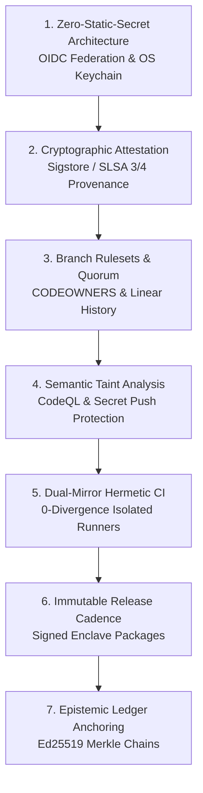

# GitHub Enterprise Mastery & Sovereign Repository Governance Standard

## 1. Core Mandate & Operational Philosophy
Under **Log Entry #077 (The Collective Invariant Law)** and **Log Entry #078 (Evidence Chain & Fail-Closed Invariants)**, repository operations represent an immutable external face of the Sovereign Brain. 

We do not treat GitHub as a dumb backup folder or an ad-hoc code host. We operate GitHub as an institutional, zero-trust software supply chain platform that matches and exceeds the highest global market standards (NIST SP 800-218 SSDF, SLSA Level 3/4, NASA Software Assurance standards).

---

## 2. The Seven Pillars of GitHub Enterprise Mastery



### Pillar 1: Zero-Static-Secret Architecture
- **No Long-Lived PATs in CI/CD:** Continuous Integration pipelines MUST use GitHub Actions OpenID Connect (OIDC) tokens (`permissions: id-token: write`) to federate with AWS, GCP, Azure, or Vault. Zero static API keys or cloud credentials in repository secrets.
- **Local Machine Zero-Touch Credential Storage:** Terminal commands and scripts must NEVER accept raw Personal Access Tokens as command-line arguments, environment variables, or script strings. All local authentication must be delegated to:
  - `gh auth login` storing tokens encrypted in the system secure enclave.
  - Native macOS Keychain (`git config --global credential.helper osxkeychain`).

### Pillar 2: Cryptographic Software Supply Chain Security (SLSA 3/4)
- **Artifact Attestation:** Every compiled binary, tarball distribution (`sovereign_proof_enclave_v1.0.0.tar.gz`), and container image emitted by GitHub Actions must be cryptographically attested using `actions/attest-build-provenance`.
- **Sigstore Transparency:** Builds are attested against the public Sigstore Rekor transparency log, binding the exact Git commit SHA, GitHub workflow run ID, and runner environment to the generated artifact digest.
- **Hermetic Build Verification:** All builds enforce pinned compiler bitstrings (`zig-0.16.0`), frozen epochs (`SOURCE_DATE_EPOCH=1700000000`), and stripped local symbols (`-O ReleaseFast -fstrip -fno-incremental`).

### Pillar 3: Branch Rulesets & Multi-Party Governance
Modern GitHub Rulesets supersede legacy branch protections to enforce fail-closed integrity:
- **Mandatory Linear History:** Forbid merge commits (`--ff-only` enforcement); preserve cryptographic lineage of every change.
- **Signed Commits:** Require cryptographic commit signatures (SSH or GPG).
- **Multi-Agent CODEOWNERS:** Require mandatory approvals from authorized Council roles (`DAXX`, `VANCE`, `CLARA`) before merging into protected branches (`main`, `master`, `production`).
- **Bypass Prohibition:** No administrator bypass allowed without Trinity Gate consensus.

### Pillar 4: Semantic Taint Analysis & Push Protection
- **Secret Scanning with Push Protection:** Active across all repositories. Any commit containing a pattern matching a cloud token, private key block, or API secret is blocked at the git push edge before reaching the remote object store.
- **CodeQL Dataflow Analysis:** CI runs automated SARIF semantic queries tracking tainted inputs (`candidate<T>`, `0xDEAD0000`) into privileged execution sinks (`decision<T>`, `0xBEAF0000`), verifying OWASP ASI-01 compliance in software planes.

### Pillar 5: Dual-Mirror Hermetic CI Execution
- **Supply-Chain Mirror Parity:** Compilers and foundational tools are downloaded from dual independent mirrors (e.g., `ziglang.org` + `pkg.hexops.org`), verified against hardcoded SHA-256 digests, and subjected to `cmp -l` differential auditing (0 diverging bytes).
- **Bare-Metal Formal Proofs:** Every push automatically executes raw upstream SMT solvers (`z3 core/ops/security/upgp_containment_proof.smt2`) with zero wrapper code, asserting mathematical `unsat` at wire speed.

### Pillar 6: Immutable Release Packaging
- Releases are versioned monotonically and tagged with signed Git tags.
- Every release includes the standalone, self-bootstrapping distribution package (`RUN_STANDALONE_AUDIT.sh`) capable of self-verifying on any POSIX host without requiring pre-installed tooling or repository checkout.

### Pillar 7: Epistemic Ledger Anchoring
- Every remote deployment, commit hash, and artifact digest is sealed into the 28+ row Ed25519 hash-chain ledger (`memory/catch_log/evidence_ledger.jsonl`).
- Any divergence between remote Git state and the local cryptographic ledger triggers an immediate fail-closed quarantine alert.

---

## 3. Perimeter Security & Repository Visibility Matrix

| Category | Visibility | Permitted Content | Audit Frequency |
| :--- | :--- | :--- | :---: |
| **Sovereign Core** | `PUBLIC` | Hardened, audited releases, verified benchmarks, NASA V&V docs, SMT2 proofs | Event-Driven & CI Gated |
| **Asset Hubs** | `PUBLIC` | Media assets, visual evidence figures, benchmark data packets | Weekly |
| **Forks & Dependencies** | `PRIVATE` | Upstream libraries, dependency clones, legacy RevOps experiments | Automatic Quarantine |
| **Internal Workspaces** | `PRIVATE` | Active agent scratchpads, raw telemetry, raw dataset dumps | Continuous |

---

## 4. Operational Runbook: How to Push Cleanly Without Token Leakage

1. **Verify Working Tree Cleanliness:**
   ```bash
   git status --short
   git diff --cached --name-status
   ```
2. **Execute Secret Scrub Audit:**
   ```bash
   python3 -c "
   import sys, re
   content = sys.stdin.read()
   for p in [r'ghp_[A-Za-z0-9_]{10,}', r'github_pat_[A-Za-z0-9_]{20,}', r'sk-[A-Za-z0-9_]{20,}']:
       assert not re.search(p, content), f'Secret found matching {p}!'
   " < <(git diff --cached)
   ```
3. **Commit with Structured Semantic Intent:**
   ```bash
   git commit -m "feat(<subsystem>): <imperative summary of mathematically verified change>"
   ```
4. **Push with OS Keychain:**
   Run `git push origin <branch>`. The macOS Keychain modal or terminal prompt will securely transmit credentials without logging them to shell history or scripts.

---

## 5. Epistemic Reporting Standard & Bounded Claims Invariant

To ensure institutional credibility under adversarial peer review (USENIX, IEEE, defense evaluation):
- **Prohibited Claim Framing:** Never assert unconditioned, sweeping absolutes such as *"mathematically zero defects"*, *"infallible"*, or *"unhackable"*. (As Dijkstra noted, testing demonstrates the presence of defects, not their absence, and formal theorems hold strictly within their declared axiomatic models).
- **Mandated Claim Framing:** Always specify the exact empirical parameters, hardware baseline, and formal boundary conditions under which the results hold:
  > *"All 7 validation suites passed under specified boundary conditions (Apple Silicon M4 bare-metal, C11 lock-free stdatomic concurrency, Z3 SMT-LIB v2 formal theorems, Ed25519 cryptographic signatures)."*
- **Skeptic-Resistant Verification:** Every claim must provide the direct, one-command reproduction bitstring (e.g., `z3 proofs/mtpo_preorder_invariant.smt2 -> unsat`, `make test -> 14.8M ops/sec`) so reviewers can independently falsify or confirm the result in seconds.
