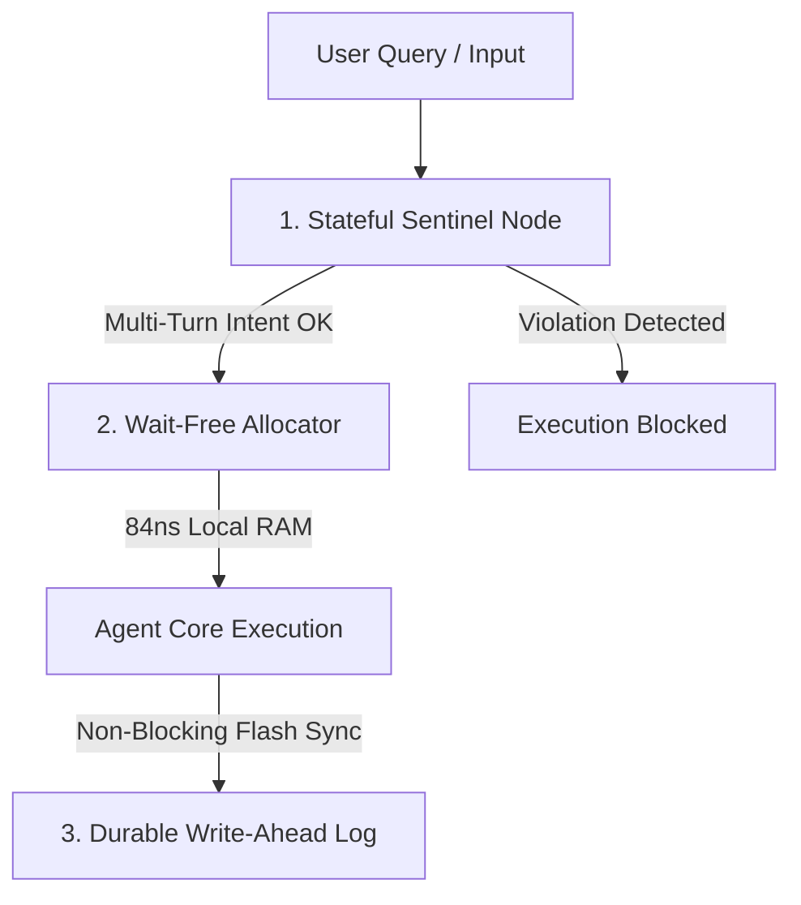

# 🛡️ Purple Concept Specification
**Project Name:** Xoras Sovereign AI Stack  
**Classification:** `[PROPRIETARY // STRATEGIC ASSET]`  
**Author:** Xoras Systems  

---

## 1. Executive Summary
The Xoras Sovereign AI Stack is a local-first memory management and semantic security engine designed to facilitate secure, high-frequency, decentralized coordination of autonomous AI agent swarms (up to 10,000 parallel nodes) on private physical hardware. 

By eliminating all external cloud dependencies, API transport layers, and centralized synchronization locks, the system ensures absolute data privacy, defense-grade air-gapped security, and sub-microsecond operational execution.

---

## 2. Core Problem Space
1.  **Semantic Attacks & Multi-Turn Drift:** Autonomous agents are highly vulnerable to adversarial prompts that bypass standard single-turn filters by distributing extraction instructions across multiple innocent conversational turns.
2.  **Concurrency Bottlenecks:** Standard memory allocators (e.g., standard malloc/free) rely on OS-level mutexes and spin-locks. Under heavy concurrent loads, threads waste CPU cycles waiting for memory access, causing thread starvation.
3.  **Data Exfiltration & Surveillance:** Cloud-dependent security layers leak context, telemetry, and private keys to third-party endpoints, breaching on-premise defense mandates.

---

## 3. High-Level Architectural Pillars

### I. Stateful Multi-Turn Sentinel
Instead of standard keyword searches, the Sentinel converts the semantic intent of every incoming query into a high-dimensional mathematical pattern. These patterns are superimposed into a decaying historical trajectory vector that preserves trace memories across dozens of turns. If the overlap between the current input and the historical path exceeds the safety budget, execution is terminated before inference begins.

### II. Lock-Free Hierarchical Allocator
Bypasses OS memory locks entirely. Each CPU core cluster operates its own local thread-local arena. Remote memory deallocations are routed via lock-free Compare-And-Swap (CAS) queues directly to thread-local mailboxes, enabling concurrent allocations without thread blocking.

### III. Durable Write-Ahead Logging (WAL)
Every memory operation, state transition, and sentinel trajectory shift is committed directly to a memory-mapped flash circular log using hardware compiler fences. Recovery is instant (under 2 milliseconds), replaying only the differential transaction log since the last hardware epoch.
