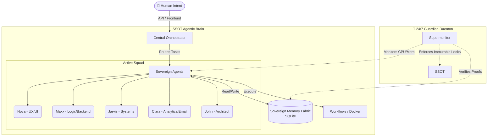

<div align="center">
  <h1>🧠 SSOT Agentic Brain</h1>
  <p><b>A Sovereign, Offline-First, M4-Accelerated AI Orchestration Framework</b></p>
  
  [](#)
  [](#)
  [](#)
  [](#)
</div>

---

## 🦅 Executive Overview
The **SSOT (Single Source of Truth) Agentic Brain** is a locally-hosted, bare-metal autonomous AI operating system designed to run securely on Apple Silicon. It shifts the paradigm from "cloud-dependent chatbots" to a **Sovereign Executive Proxy** that executes complex workflows autonomously.

Powered by a continuously running `Elephant Guardian` daemon and a local `Sovereign Memory Fabric`, this system Percieves, Reasons, Acts, and Learns (POAL) entirely on its own infrastructure.

## 🏗️ System Architecture



## 📂 Repository Structure

The architecture is highly opinionated, dividing the workspace by lifecycle phase:

```text
SSOT_Agentic_Brain/
├── 🤖 core_agents/          # AI Core logic, active agent profiles, and RAG indexers
├── 🚀 deployed_projects/    # Production-ready, enterprise-grade validated tools
├── 🔬 research/             # System documentation, blueprints, and context artifacts
├── ⚙️ ops/scripts/          # Automation scripts, daemons, and audio generation
│   ├── orchestrator_server.py
│   ├── task_guardian_daemon.py
│   └── remediatory_audit_engine.py
├── 📁 memory/               # Sovereign Memory Fabric (Journals, DBs, Proofs)
└── 🏚️ the_barn/             # Cold-storage archive for legacy experiments and drafts
```

## 🛡️ Core Protocols

* **The Elephant Guardian Protocol**: A 24/7 background daemon (`task_guardian_daemon.py`) that monitors runaway processes, kills stuck loops after 300s, and writes immutable proofs to the memory ledger.
* **Byzantine Fault Tolerance**: Built-in remediatory audit engines sweep the infrastructure to detect missing permissions, orphaned files, and broken links, generating cryptographic SHA-256 proofs of all repairs.
* **Human-In-The-Middle (HITL) Gates**: Critical deployments and structural changes require explicit user authorization via an interactive decision dashboard.
* **Perimeter Lockdown**: The entire repository defaults to immutable (`uchg` flags) to prevent unauthorized structural changes, ensuring total sovereignty.

## 🚀 Bootstrapping

Initialize the Sovereign environment:

```bash
# 1. Unlock the perimeter temporarily
chflags -R nouchg /path/to/SSOT_Agentic_Brain

# 2. Boot the Elephant Guardian and Orchestrator
python3 ops/scripts/task_guardian_daemon.py &
python3 ops/scripts/orchestrator_server.py &

# 3. Access the Live Dashboard
open http://localhost:8080
```

---
<div align="center">
<i>"We perceive, we reason, we act, and we learn. The bridge between your vision and the machine."</i>
</div>
