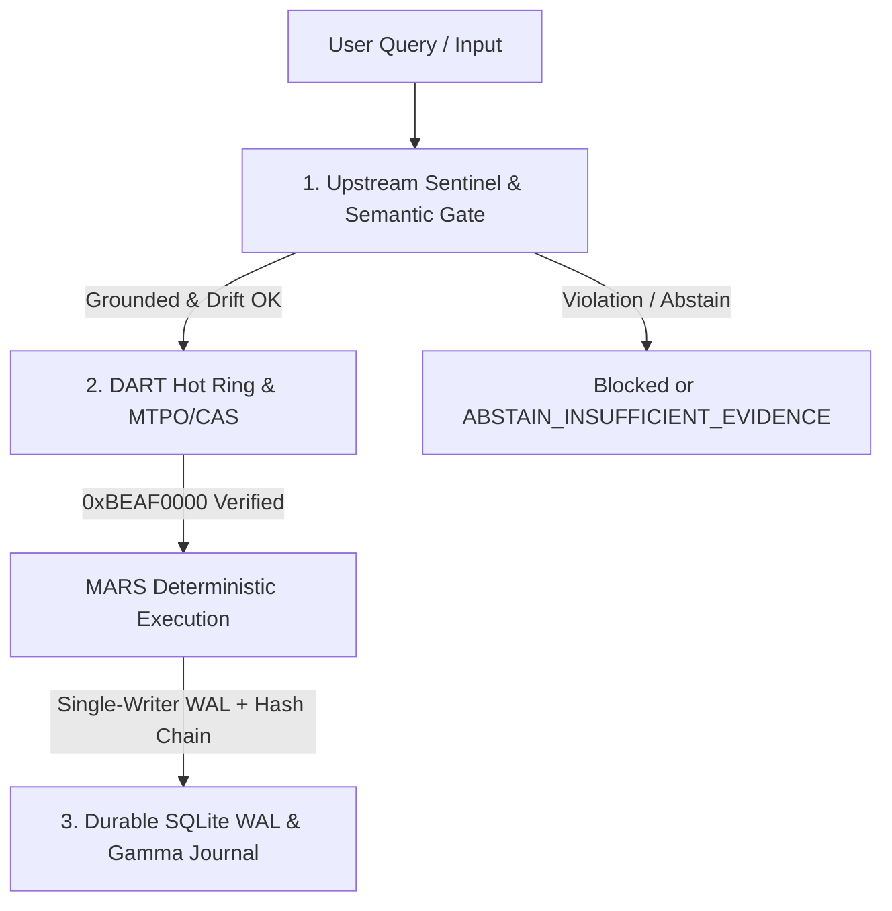

# 🛡️ Purple Concept Specification
**Project Name:** XORAS Sovereign AI Stack  
**Status:** `ARCHIVED CONCEPT SPEC — ALIGNED TO 5.0.0-rc.1 (HOLD)` (see root `README.md` for live receipt-backed status)  
**Classification:** `[PROPRIETARY // STRATEGIC ASSET]`  
**Author:** XORAS Systems  

---

## 1. Executive Summary
The XORAS Sovereign AI Stack is a local-first memory management, verification, and semantic security substrate designed to coordinate autonomous multi-agent workflows on private physical hardware (Apple Silicon M4 and local LAN compute).

By operating local-first without external cloud inference dependencies, the system enforces strict dual-plane separation (`REASONS -> MTPO -> MARS`, backed by `DART`), deterministic pre-execution checks, and receipt-backed state transitions (`memory/catch_log/REALITY_GATE_RECEIPT.json`).

---

## 2. Core Problem Space
1. **Semantic Attacks & Multi-Turn Drift:** Autonomous agents are vulnerable to adversarial prompts that bypass naive single-turn filters or shift intent across turns.
2. **Concurrency & Non-Monotonic State Corruption:** Standard multi-agent frameworks overwrite history or suffer lock contention when mutating shared state concurrently.
3. **Unverified Claims & Exfiltration:** Cloud-dependent or post-hoc-only pipelines can leak context or emit ungrounded arguments before verification runs.

---

## 3. High-Level Architectural Pillars

### I. Upstream Sentinel & Semantic Drift Gate
Instead of relying solely on post-hoc keyword filters, incoming transitions pass through deterministic semantic drift gating (`core/ops/memory/poincare_semantic_gate.py`, using 1-D log-radial scalar mapping and character-trigram lexical hashing on the Poincaré disk—not neural embeddings) paired with `UpstreamClaimGate` (`core/ops/discernment/upstream_claim_gate.py`), which enforces retrieval-span citations and forces `ABSTAIN_INSUFFICIENT_EVIDENCE` when evidence is missing.

### II. DART Hot Ring & MTPO / CAS Concurrency
Hot-path transitions are buffered in the `DART` (`Data Accounts Reverse/Recall Tracking`) `4,096 × 512`-byte HexCell ring (`core/memory/dart_ring_buffer.py`) with capability-lattice enforcement (`PUBLIC < INTERNAL < RESTRICTED < SEALED`), while **MTPO (Monotonic Trajectory Pre-Order)** and **MARS (Model-Agnostic Reversible State)** enforce monotonic state ordering (`0xDEAD0000` speculative taint to `0xBEAF0000` verified execution) and append-only inverse deltas ($\Delta^{-1}$).

### III. Durable Write-Ahead Logging (WAL) & Hash-Chained State
Durable state commits to single-writer SQLite WAL (`memory/tri_brain/world_file.db`, `BEGIN IMMEDIATE` with `CAS_REJECT` on step regressions) and `DartDb`, alongside the append-only SHA-256 hash-chained `knowledge_objects.jsonl` journal (`core/ops/scripts/retain_recall.py`, with non-destructive `RETRACTION`). Governed checkpoint and adversarial head-to-head receipts live in `memory/catch_log/BLACKBOARD_MCP_HEAD_TO_HEAD_RECEIPT.json` (`5/5` adversarial blocks vs. `0/5` unprotected baseline; `~239.5 μs` mean checkpoint latency locally).
