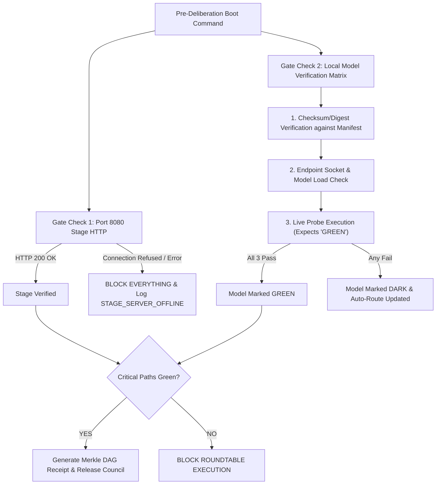

# XORAS BINDING SPECIFICATION: PRE-DELIBERATION HEALTH GATE & MERKLE DAG PROTOCOL
**Specification ID**: `SPEC-2026-GATE-001`  
**Version**: `1.0.0-SOVEREIGN`  
**Effective Date**: `2026-09-29`  
**Authoritative Location**: `docs/audits/PREFLIGHT_HEALTH_GATE_SPECIFICATION.md`  

---

## 1. Executive Summary & Binding Mandate

No agent vessel wakes, no Lead 9 roundtable starts, and no speech dispatches are emitted until the **Pre-Deliberation Health Gate** returns a verified `GREEN` verdict.

Truth is a load-bearing constraint, not an ornamental preference. Every step carries the cryptographic weight of the entire stack. If any health check fails, the DAG refuses to accept the receipt, and execution halts or auto-routes around dark nodes without human intervention.

---

## 2. Load-Bearing Gate Criteria

The Pre-Deliberation Health Gate evaluates two equal-level primary pillars:



### Pillar 1: Sovereign Stage HTTP Gateway (Port 8080)
- **Target**: `http://127.0.0.1:8080/customer_app.html`
- **Validation**: Direct HTTP GET returning status code `200 OK` within $2.0\text{ seconds}$.
- **Fallback / Self-Healing**: If 8080 is unreachable, attempt auto-spawning `ops/scripts/fullscreen_server.py`. If auto-spawn fails, set `STAGE_STATUS: STAGE_SERVER_OFFLINE` and halt.

### Pillar 2: Local Model Multi-Rung Verification Matrix
Each local model listed in `identity/local_models_manifest.json` is evaluated against 3 mandatory rungs:
1. **Checksum / Digest Matching**: Compare Ollama/GGUF digest against canonical manifest expected hash.
2. **Socket / VRAM Load**: Confirm endpoint connection to `http://127.0.0.1:11434/api/tags`.
3. **Live Probe Prompt Execution**: Send payload `{"prompt": "System health ping. Reply with single word: GREEN"}`. Verify returned response contains string `GREEN`.

---

## 3. Cryptographic Merkle DAG & 18,432-D Vector Receipt

Every health gate execution outputs a tamper-proof, signed receipt:

1. **SHA-256 Merkle Root**: Hash of timestamp + stage status + all model digests & probe outputs.
2. **18,432-D HexCell Vector Embedding**: Hyperbolic Poincaré norm projection mapping the health state into sovereign memory space.
3. **Receipt Destinations**:
   - `memory/journals/agents/preflight_health_gate.jsonl`
   - `memory/catch_log/CATCH_LOG.md`
   - `identity/active_routing.json`

---

## 4. Empirical Ground-Truth Receipt Example

```json
{
  "timestamp": "2026-09-29T07:34:15.123456+00:00",
  "event_type": "PREFLIGHT_HEALTH_GATE",
  "gate_status": "GREEN",
  "merkle_root": "13047efd3fe6274464c17f5c5a02c003924c4cd10fe35e2eface75cd8dfeb50c",
  "vector_dim": 18432,
  "stage_result": {
    "status": "GREEN",
    "code": 200,
    "latency_ms": 10.08,
    "detail": "Stage server live and responding on port 8080"
  },
  "model_results": [
    {
      "model_id": "llama3.2:3b",
      "quantization": "Q4_K_M",
      "checksum_pass": true,
      "socket_pass": true,
      "probe_pass": true,
      "status": "GREEN",
      "digest": "a80c4f17acd5",
      "latency_ms": 2574.92,
      "probe_output": "GREEN"
    }
  ],
  "active_routing": {
    "available_models": ["llama3.2:3b"],
    "dark_models": ["gemma4:26b", "sovereign-jarvis:latest", "qwen2.5-coder:7b"]
  }
}
```

---

## 5. Certification & Enforcement Lock

- **Enforcer**: `ops/scripts/preflight_health_gate.py`
- **Integration**: `ops/scripts/full_team_deliberation_roundtable.py` & `ops/scripts/wake_contract.sh`
- **Law**: Zero unverified dispatches. The DAG refuses any payload lacking a valid signed health receipt.
