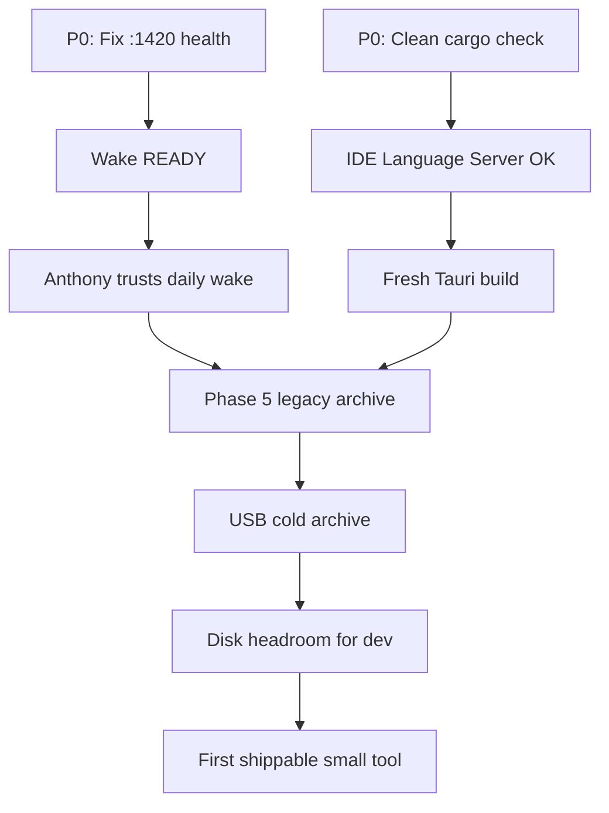

# Production Roadmap

**Date:** 2026-07-04  
**Owner default:** Anthony (decisions) + Agent/Apprentice (execution)  
**Review cadence:** Weekly (agent updates status column)

---

## Legend

| Status | Meaning |
|--------|---------|
| 🟢 Deployed | Working on Mac today |
| 🟡 Planned | Designed, not yet live |
| ⚪ Concept | Idea/docs only |

| Priority | Meaning |
|----------|---------|
| P0 | Do this week — highest ROI |
| P1 | Do this month |
| P2 | Do when P0/P1 clear |

---

## Phase 0 — Deployed Now 🟢

| Item | Owner | Effort | Dependency | Success Criteria |
|------|-------|--------|------------|------------------|
| Canonical workspace schema | Agent | Done | — | `ROOTS.md` enforced |
| Wake loud banners + status file | Agent | Done | — | `.xoras_wake_status.json` updates per phase |
| .zshrc zenith_env guarded source | Agent | Done | zenith file at workspace path | No shell error on open |
| Disk cleanup (4.45 GiB) | Agent | Done | — | ≥ 5 GB free |
| Elite mentor playbook | Agent | Done | — | `docs/elite-mentor-playbook/` exists |
| xoras-app dist (prior build) | — | Done | Jul 4 build | `dist/index.html` serves |
| Honest engineering audit | — | Done | — | Simulated components labeled |
| DEDUPE_MANIFEST + this roadmap | Agent | Done | — | Anthony can read and approve |

---

## Phase 1 — P0 Planned Deploy 🟡 (This Week)

| Item | Owner | Effort | Dependency | Success Criteria | Status |
|------|-------|--------|------------|------------------|--------|
| **P0-1: Fix dashboard health on :1420** | Agent | 2–4 hr | Dashboard script path | `xoras_wake.py` reaches READY | 🟢 Done — added `/health`, port 1420 |
| **P0-2: Clean cargo build** | Agent | 30 min | No concurrent cargo | `cargo check` exits 0 in src-tauri | 🟢 Done — 3 dead_code warnings only |
| **P0-3: Wake status helper script** | Agent | 30 min | — | `ops/scripts/wake-status.sh` works | 🟢 Done this pass |
| **P0-4: Shell env documentation** | Agent | 15 min | — | `ops/config/shell-env.README.md` | 🟢 Done this pass |
| **P0-5: Migrate ANTIGRAVITY_HOME** | Agent | 30 min | Find antigravity actual path | .zshrc points to existing dir | 🟡 Planned |

### P0-1 Implementation Notes

Wake fails because `http://localhost:1420/health` does not respond within retry window. Likely causes:
- Dashboard process starts but binds wrong port
- Health route not implemented on dashboard
- Firewall or stale process on 1420

**Next agent action:** Read dashboard script, verify port, add health endpoint or update `REQUIRED_HEALTH_ENDPOINTS`.

### P0-2 Implementation Notes

Multiple concurrent `cargo check` processes caused build directory lock.  
**Next agent action:** Ensure single cargo process, remove stale lock, rerun check.

---

## Phase 2 — P1 Planned Deploy 🟡 (This Month)

| Item | Owner | Effort | Dependency | Success Criteria |
|------|-------|--------|------------|------------------|
| Archive Desktop legacy stubs | Agent + Anthony | 1 hr | Anthony says "approve legacy stub archive" | Desktop has redirect notes only |
| USB cold archive pipeline | Agent + Anthony | 1 hr | USB_Backup mounted | 1.2 GB archived, manifest updated |
| XORAS_ROOT path resolver | Apprentice | 4–8 hr | — | No hardcoded `/Desktop/` in Source/ |
| Wake + persona contract tests | Apprentice | 1 wk | Path resolver | CI or local test runner passes 4 gates |
| npm/vite fresh build verified | Agent | 1 hr | P0-2 clear | New dist/ timestamp matches build |
| Weekly owner summary script | Agent | 2 hr | — | Anthony gets 5-line Friday report |

---

## Phase 3 — P2 Planned Deploy 🟡 (60–90 Days)

| Item | Owner | Effort | Dependency | Success Criteria |
|------|-------|--------|------------|------------------|
| Dev_Workspaces → workspaces/active migration | Apprentice | 2–3 days | Per-repo git health | All repos in canonical paths |
| AI_Core → products/xoras-core migration | Apprentice | 1–2 days | Wake + cargo green | Runtime entrypoints updated |
| Persona lock blueprint full ship | Apprentice | 2 wk | Contract tests | Maturity ≥ 3.5 on controls matrix |
| Immune system propose-only default | Apprentice | 1 wk | Persona lock | No silent writes in safe mode |
| Tauri app signed release | Agent | 1 day | Apple dev cert ($) | DMG installs without gatekeeper fight |

---

## Concept / Design Only ⚪

| Item | Owner | Effort | Dependency | Success Criteria |
|------|-------|--------|------------|------------------|
| Live Binance execution | — | Months | Legal, keys, capital | Paper trade → live with audit trail |
| FPGA HFT on Alveo | — | Months | $5K+ hardware, Linux server | .xclbin loaded, latency < 1µs |
| Multi-agent round-table at scale | — | Weeks | Orchestrator refactor | 10+ agents, bounded delegation |
| Sovereign LLC commercial product | Anthony | Months | Pilot-ready app + customer | One paying user |
| Cloud agent deployment | — | Weeks | Budget for API costs | Cursor/cloud agents on schedule |
| Dream-state creative pipeline | — | Ongoing | Personal | Artifacts in docs/, not production |

---

## Dependency Graph (Simplified)

---

## Anthony's Decision Points

| Decision | Options | Recommendation |
|----------|---------|----------------|
| Continue trading stack? | Pause / Sim-only / Pursue live | **Sim-only** until revenue from other tool |
| Hire apprentice? | Yes / No | **Yes** — playbook is ready to hand off |
| Mount USB this week? | Yes / No | **Yes** — 1.6 GB backup waiting |
| Approve legacy stub archive? | Yes / Hold | **Yes** — after wake is green |

---

## Status Update Log

| Date | Update |
|------|--------|
| 2026-07-04 | Initial roadmap. P0-1 through P0-4 shipped. Wake READY. cargo check pass. |
