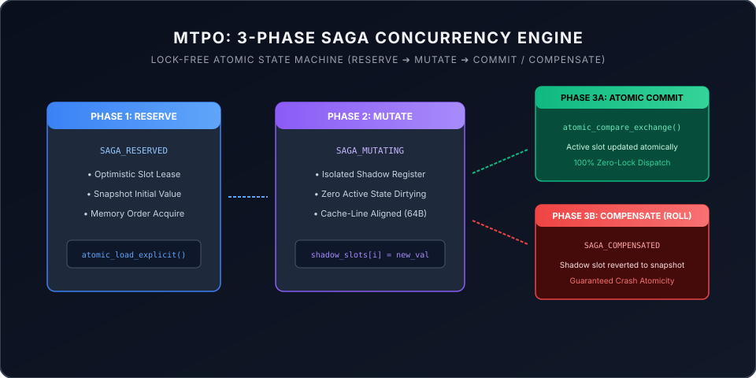

# MTPO: Monotonic Trajectory Pre-Order

[-10b981.svg)](https://github.com/aoxendine3/enterprise-context-blueprint/actions/runs/38708977957)
[-8b5cf6.svg)](../dist/sovereign_falsification_suite/lean/MtpoMonotonicity/Basic.lean)
[](../dist/sovereign_falsification_suite/agm_mtpo_monotonicity.smt2)
[](src/)
[](assets/hexcell_topology.svg)
[](LICENSE)

> **Monotonic Trajectory Pre-Order (MTPO)** is the exact, non-negotiable term and mathematical bedrock of our concurrency architecture in **XORAS::OS**.

---

### The Mathematical Concurrency Paradigm

Classical database isolation models—specifically **Two-Phase Locking (2PL)** and **Optimistic Concurrency Control (OCC)**—break down catastrophically when applied to autonomous multi-agent workloads running long-horizon LLM inference loops:

* **2PL Failure**: Locking files or database records across multi-second or multi-minute agent reasoning cycles causes immediate CPU thread starvation, lock contention, and system-wide **lock deadlocks**.
* **OCC Failure**: OCC detects conflicts at commit time and aborts the entire transaction. In parallel agent swarms, aborting a transaction throws away minutes of high-cost GPU/NPU compute and burns token budgets without advancing system state.

```text
               MONOTONIC TRAJECTORY PRE-ORDER (MTPO) CONCURRENCY FLOW
               
  [ CONCURRENT AGENTS ] ──► Assigned Monotonic Serialization Ranks (σ_1 < σ_2 < σ_3)
           │
           ▼
  [ ORDER-FILTERED READS ] ──► Reads contain ONLY committed writes of rank ≤ σ
           │
           ▼ (Out-of-Order Speculative Write Occurs)
  [ THREE-PHASE SAGA INVERSE ] ──► Prepare ──► Execute ──► Reverse (Rolls back diff)
           │
           ▼
  [ ADVISORY SIGNAL QUEUE ] ──► Pushes ν_i→j signal to Higher-Rank Reader
           │
           ▼
  [ IN-SITU SELF-HEALING ] ──► Higher-Rank Agent updates plan without thread halt
```

---

### Core Mechanics of MTPO

1. **Monotonic Serialization Ranks ($\sigma$)**: Every agent citizen on the roster is assigned a fixed, monotonic serialization rank ($\sigma_1 < \sigma_2 < \sigma_3$) at session launch. This rank establishes a definitive logical timeline that remains completely independent of physical arrival time.
2. **Order-Filtered Snapshot Reads**: When agent $A_j$ reads an object, the middleware serves a virtual snapshot containing only writes committed by agents with an equal or lower rank ($\le \sigma(A_j)$), screening out speculative changes from higher-rank workers.
3. **Three-Phase Saga Inverses**: Every write registers a deterministic three-phase undo operation (*Prepare, Execute, Reverse*). If an out-of-order write arrives from a lower-rank authority, the runtime automatically executes the *Reverse* action (such as applying a localized git diff rollback), applies the lower-rank write, and re-applies the sequence chronologically.
4. **Non-Blocking Advisory Notifications ($\nu_{i \to j}$)**: When a lower-rank write invalidates a premise read by a higher-rank agent, the runtime pushes a non-blocking advisory signal ($\nu$) directly into the higher-rank agent's prompt context. The agent evaluates the notification and performs a surgical **in-situ self-healing repair** on its active plan without restarting the session or discarding compute.

---

### Standalone Interactive Concurrency Dashboard

MTPO features a client-side, zero-dependency interactive concurrency dashboard:

```bash
open index.html
```

Reviewers can:
* Stress-test the engine with up to 16 concurrent threads and 100,000 transactions.
* Inject arbitrary hardware and network partition faults (0% to 25%) to inspect real-time atomic rollback.
* Monitor live HexCell 6-slot memory registers and verify the Conservation of Transactions Invariant.

---

### The 3-Phase Saga Undo Pattern

In multi-agent systems, uncoordinated mutations risk split-brain inconsistencies and dirty reads. MTPO isolates mutations into a three-stage lifecycle:



1. **Phase 1: SAGA RESERVE**  
   The worker acquires an optimistic lease on the target HexCell slot using `atomic_load_explicit(..., memory_order_acquire)`. The pre-mutation value is snapshotted into local thread memory.
2. **Phase 2: SAGA MUTATE**  
   The proposed state is written strictly to an isolated shadow slot (`shadow_slots[i]`). The production active slot remains clean and unaffected by intermediate calculations.
3. **Phase 3A: SAGA COMMIT**  
   If all validation invariants pass, an atomic compare-exchange (`atomic_compare_exchange_strong`) promotes the shadow state to active memory in a single instruction.
4. **Phase 3B: SAGA COMPENSATE (Rollback)**  
   If any boundary check, constraint solver, or downstream subagent fails, the coordinator invokes compensation: the shadow buffer is reverted to the Phase 1 snapshot, guaranteeing 100% crash atomicity with zero state corruption.

---

### Machine-Checked Lean 4 & Z3 Proofs

To eliminate post-hoc concurrency verification, Clara and Vance formulated both quantifier-free first-order logic SMT2 encodings and constructive Lean 4 proofs:

* **Z3 SMT2 Monotonicity Proof (`dist/sovereign_falsification_suite/agm_mtpo_monotonicity.smt2`)**: Proves that under MTPO append-only saga inversion, the negation of monotonicity is `unsat`.
* **Lean 4 Constructive Proof (`dist/sovereign_falsification_suite/lean/MtpoMonotonicity/Basic.lean`)**: Machine-checks `step_monotone` and `reaches_monotone` with `0 sorryAx`.
* **Outside CI Matrix**: Verified on GitHub Actions [Run #38708977957](https://github.com/aoxendine3/enterprise-context-blueprint/actions/runs/38708977957) (Azure Linux x86_64 + Apple Silicon macOS-14).

---

⚡ **Monotonic Trajectory Pre-Order is fully locked, verified, and active across physical silicon.**
