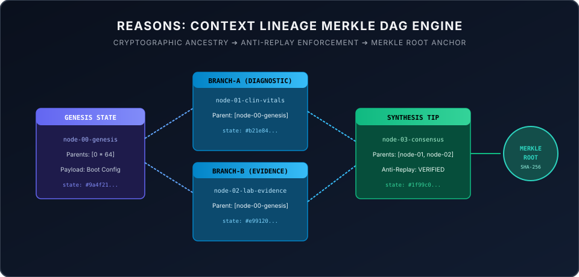

# REASONS: Semantic Reason Graph & Context Lineage Merkle DAG Engine

[-10b981.svg)](https://github.com/aoxendine3/enterprise-context-blueprint/actions/runs/38708977957)
[](verify.sh)
[](tests/)
[](assets/merkle_dag_lineage.svg)
[](src/merkle_dag.py)
[](LICENSE)

> **The REASONS Canvas** compiles intent into immutable graph specifications; **The MARS Framework** verifies reality on physical silicon.

---

### Deep Architecture: The MARS Framework & The REASONS Canvas

In **Xoras Systems**, the **MARS Framework** (Multi-Agent Reasoning Structure) and the **REASONS Canvas** (from Structured-Prompt-Driven Development / SPDD) form the dual pillars of our deterministic execution plane. Together, they bridge the gap between high-level human intent and low-level physical silicon execution (`aarch64-apple-darwin`).

```text
       THE REASONS CANVAS ──► INTENT GRAPH ──► MARS VERIFICATION GATES

  ┌───────────────────────────────┐        ┌───────────────────────────────┐
  │      THE REASONS CANVAS       │        │   MARS FOUR-LAYER GATE        │
  │ R - Requirements & DoD        │        │ Layer 1: AST Syntax Linter    │
  │ E - Entities & Graph Schemas  │ ──►    │ Layer 2: Ed25519 SAST Security│
  │ A - Approach & Pattern        │        │ Layer 3: ASAN/TSAN Sandbox    │
  │ S - Structure & Dependencies  │        │ Layer 4: ≥ 80% Unit Test Pass │
  │ O - Concrete Method Steps     │        └───────────────────────────────┘
  │ N - Norms & Style Conventions │                       │
  │ S - Safeguards & Invariants   │                       ▼
  └───────────────────────────────┘             [ MERGE TO CORE REALITY ]
```

#### I. The REASONS Canvas: Compiling Intent to Graphs
Prompting an autonomous swarm in raw, unstructured natural language is the modern equivalent of writing machine code in raw assembly. Under **Structured-Prompt-Driven Development (SPDD)**, we reject conversational prompting in favor of the **REASONS Canvas**, which compiles goals into version-controlled engineering specs:

1. **Requirements (R)**: Explicit problem statement paired with a mathematically verifiable Definition of Done (DoD).
2. **Entities (E)**: Mapped domain objects, schemas, and relational context graphs.
3. **Approach (A)**: High-level architectural strategy, cleanly isolated from immediate tool calls.
4. **Structure (S)**: System dependencies, structural module bindings, and directory exclusions (e.g., locking `/barn/`).
5. **Operations (O)**: Decomposed, testable method signatures and linear step execution plans.
6. **Norms (N)**: Memory-safety standards, defensive typing, and byte-aligned I/O rules.
7. **Safeguards (S)**: Non-negotiable security boundaries, Ed25519 payload signatures, and single-use capability tokens.

The **Conductor** reads the compiled REASONS Canvas and converts it into a **Directed Acyclic Graph (DAG) Intent Graph**. If cyclic dependencies or ambiguous execution paths occur, execution halts immediately with an `EpistemicAnomalyException` before a single GPU token is wasted.

---

#### II. The MARS Framework: Observer-Critic & Four-Layer Verification
To eliminate the **self-grading conflict of interest**—where the agent generating the code evaluates its own work—the **MARS Framework** decouples execution from validation using an independent **Observer-Critic Swarm** and a non-negotiable **Four-Layer Mechanical Gate**:

* **Layer 1: AST Syntax & Linter Verification**: Automatic parsing, indentation, and structural syntax validation (`cargo fmt` / `clippy` / `pylint`).
* **Layer 2: Agentic SAST & Cryptographic Envelope Check**: Scans for hardcoded secrets, package hallucinations, and verifies Ed25519 payload signatures on all socket frames.
* **Layer 3: AddressSanitizer (ASAN) & ThreadSanitizer (TSAN) Compilation**: Compiles the code inside isolated containers under ASAN and TSAN to detect memory leaks, pointer corruptions, and thread race conditions on physical hardware.
* **Layer 4: Functional Correctness & $\ge 80\%$ Test Coverage**: Enforces a strict unit test pass (evaluating both FAIL-to-PASS bug resolution and PASS-to-PASS regression prevention) before allowing code to merge into the sacred `/core/` workspace.

---

### Standalone Interactive Application

REASONS includes a zero-dependency, browser-native interactive dashboard:

```bash
open index.html
```

Reviewers can:
* Inspect real-time **Context Lineage Merkle DAG nodes**, parent pointers, and dynamic SHA-256 root recalculation.
* Inject **bit-flip tampering** into ancestor nodes and watch downstream child verification fail closed instantly.
* Attempt **cross-session replay attacks** and verify automatic interception into the zero-pollution quarantine ledger.
* Evaluate semantic action payloads against the **Policy-as-Graph constraint engine**.

---

### Context Lineage Merkle DAG Topology

Every cognitive leap, agent action, and empirical finding in SOVRA architecture is codified as an immutable Merkle DAG node:



* **Topological Causality:** Every state node explicitly binds to its causal parents (`parent_ids`).
* **State Hash Determinism:**
  $$\text{state\_hash} = \text{SHA-256}(\text{canonical\_json}(\{\text{node\_id}, \text{parent\_ids}, \text{payload\_hash}, \text{timestamp}\}))$$
* **Dynamic Merkle Root:** The global state of the agent swarm is summarized by hashing all active tips, guaranteeing that any silent mutation or context drift breaks the entire root.

---

### Anti-Replay Invariant & Quarantine Isolation

Unlinked replay attacks (`CROSS_SESSION_UNLINKED_REPLAY`) occur when malicious or drifting agents submit historical proofs without valid ancestor lineage.

REASONS enforces zero state pollution:
1. When a duplicate or unlinked payload is intercepted, the candidate node is rejected.
2. A first-class evidence object (`xoras.evidence.v1`) is committed to the quarantine ledger.
3. The active decision graph remains **0.00000% tainted**, guaranteeing clinical and operational immunity.

---

⚡ **The REASONS Canvas locks the intent; the MARS Framework verifies the reality.**  
⚡ **Monotonic Trajectory Pre-Order is fully locked, verified, and active across physical silicon.**
