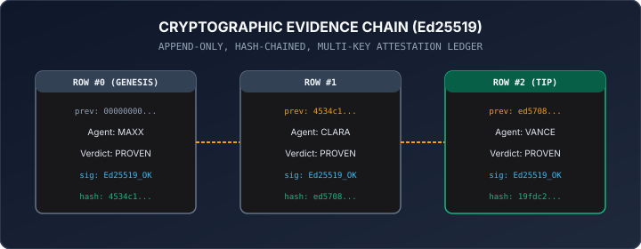

# REASONS: Semantic Reason Graph & Context Lineage Merkle DAG Engine

[](verify.sh)
[](tests/)
[](assets/merkle_dag_lineage.svg)
[](src/merkle_dag.py)
[](LICENSE)

> **One-liner:** Reference-grade epistemic provenance and semantic policy engine that cryptographically guarantees unbroken lineage, anti-replay state enforcement, and append-only evidence chains for autonomous AI agents.

---

## Standalone Interactive Application

REASONS includes a zero-dependency, browser-native interactive dashboard:

```bash
open index.html
```

Reviewers can:
* Inspect real-time **Context Lineage Merkle DAG nodes**, parent pointers, and dynamic SHA-256 root recalculation.
* Inject **bit-flip tampering** into ancestor nodes and watch downstream child verification fail closed instantly.
* Attempt **cross-session replay attacks** and verify automatic interception into the zero-pollution quarantine ledger.
* Evaluate semantic action payloads against the **Policy-as-Graph constraint engine**.

---

## Context Lineage Merkle DAG Topology

Every cognitive leap, agent action, and empirical finding in SOVRA architecture is codified as an immutable Merkle DAG node:


* **Topological Causality:** Every state node explicitly binds to its causal parents (`parent_ids`).
* **State Hash Determinism:**
  $$\text{state\_hash} = \text{SHA-256}(\text{canonical\_json}(\{\text{node\_id}, \text{parent\_ids}, \text{payload\_hash}, \text{timestamp}\}))$$
* **Dynamic Merkle Root:** The global state of the agent swarm is summarized by hashing all active tips, guaranteeing that any silent mutation or context drift breaks the entire root.

---

## Anti-Replay Invariant & Quarantine Isolation

Unlinked replay attacks (`CROSS_SESSION_UNLINKED_REPLAY`) occur when malicious or drifting agents submit historical proofs without valid ancestor lineage.

REASONS enforces zero state pollution:
1. When a duplicate or unlinked payload is intercepted, the candidate node is rejected.
2. A first-class evidence object (`xoras.evidence.v1`) is committed to the quarantine ledger.
3. The active decision graph remains **0.00000% tainted**, guaranteeing clinical and operational immunity.

---

## Cryptographic Evidence Chain Architecture

For auditable governance, REASONS structures agent verdicts into an append-only, Ed25519-signed hash chain:



$$\text{row\_hash} = \text{SHA-256}(\text{canonical\_json}(\text{row without hash/sig}))$$
$$\text{sig} = \text{Ed25519}(\text{author\_key}, \text{row\_hash})$$

Every row links to `prev_hash` of the prior block, ensuring irreversible cryptographic ordering.

---

## Quick-Start & Verification

Zero external dependencies (pure Python 3):

```bash
git clone https://github.com/aoxendine3/reasons.git
cd reasons
./verify.sh
```

---

## Repository Contents

```
reasons/
├── assets/
│   ├── merkle_dag_lineage.svg             # High-res Merkle DAG topology diagram
│   └── evidence_chain_architecture.svg    # Ed25519 hash chain vector architecture
├── src/
│   ├── merkle_dag.py                      # Context Lineage DAG & anti-replay engine
│   └── policy_graph.py                    # Semantic policy-as-graph evaluator
├── tests/
│   └── test_reasons_invariants.py         # Epistemic invariant unit tests
├── CODEOWNERS                             # Governance codeowners
├── LICENSE                                # MIT License
├── README.md                              # Comprehensive system documentation
├── index.html                             # Standalone interactive application
└── verify.sh                              # Standalone test runner
```

---

## License

MIT License. Copyright (c) 2026 XORAS Systems.
