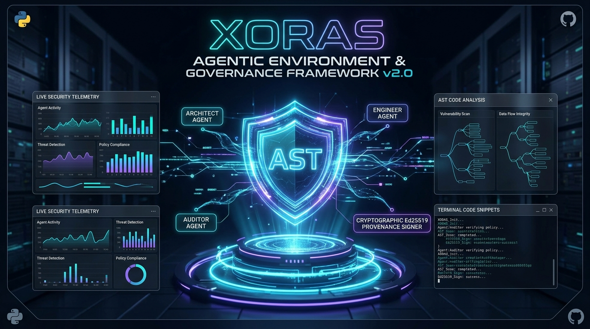
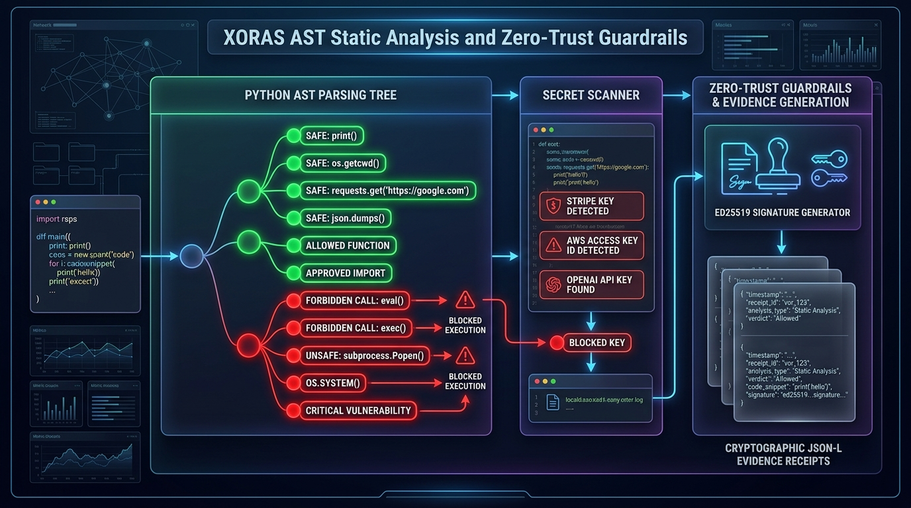
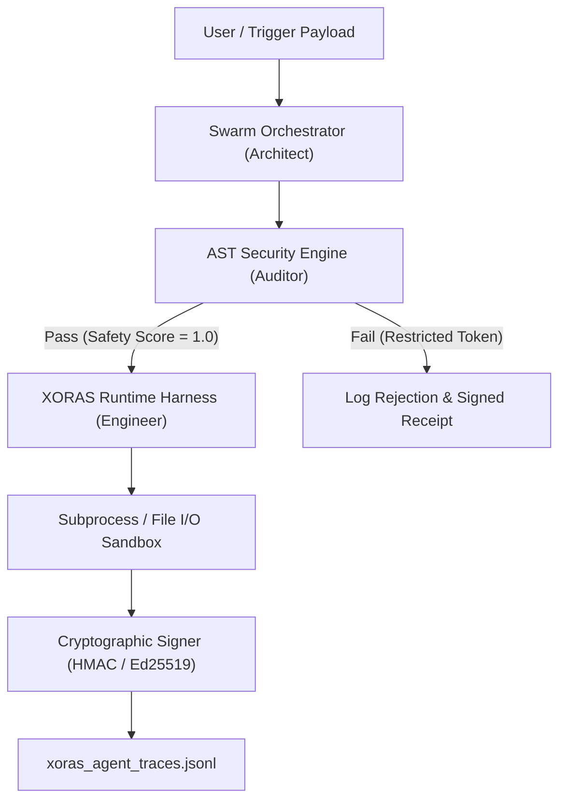

# XORAS Agentic Environment & Governance Framework v2.0



[](https://pypi.org/project/xoras-agent-framework/)
[](LICENSE)
[](#ast-static-security-gating)
[](#testing)

**XORAS Agentic Environment & Governance Framework** is an enterprise-grade multi-agent runtime, dynamic AST security scanner, and cryptographic provenance platform developed by **XORAS Systems LLC**.

---

## 🛡️ AST Security Architecture & Guardrails



## Key Features

- **AST Static Security Gating (`env-integrity-sentry`)**: Real-time Abstract Syntax Tree parsing and secret scanning that intercepts dangerous code injections (`eval`, `exec`, `subprocess shell=True`) and credential leaks prior to execution.
- **Cryptographic Trace Receipts (`xoras.evidence.v1`)**: Every agent state transition and tool invocation generates an Ed25519 / HMAC SHA-256 signed JSON-L trace receipt for 100% zero-falsification audit trails.
- **Enterprise SIEM & Log Exporters**: Formatted log streaming plugins for **Datadog**, **Splunk**, **Elasticsearch**, and **Syslog**.
- **Automated SOC2 & ISO 27001 AI Compliance Auditor**: Built-in compliance auditor (`SOC2ComplianceAuditor`) that evaluates trace receipts and issues automated audit certificates.
- **Polyglot & WASM Micro-Runtime IPC Bridge**: Extends security gating to external C++, Rust, Zig, and WASM binary micro-runtimes.
- **Pre-Commit Git Integration**: Standalone `.pre-commit-hooks.yaml` config allowing engineering teams to run `xoras scan` in git pre-commit hooks.

---

## Architecture Overview



---

## Quickstart & Installation

### 1. Install Package
```bash
pip install xoras-agent-framework
```

### 2. Initialize Governance Environment
```bash
xoras init
```
This generates `.xorasrules` and `xoras.env.yaml` in your workspace root.

### 3. Scan Scripts for AST Violations
```bash
xoras scan my_script.py
```

### 4. Run Scripts in Isolated Sandbox
```bash
xoras run my_script.py
```

### 5. Serve Interactive Web Dashboard
```bash
xoras serve --port 8080
```
Open `http://localhost:8080` to view the live product landing page and interactive AST playground.

---

## Python API Usage

```python
from xoras import XORASAgentEnvironment, SwarmOrchestrator

# Initialize environment
env = XORASAgentEnvironment(config_path="xoras.env.yaml")

# Run multi-agent orchestrator pipeline
orchestrator = SwarmOrchestrator(env=env)
result = orchestrator.run_pipeline(
    task_description="Deploy verified configuration file",
    code_payload='{"status": "active", "version": "2.0.0"}',
    target_path="artifacts/deploy_config.json"
)

print("Pipeline Success:", result["success"])
print("Trace Signature:", result["last_signature"])
```

---

## Testing

Run the automated test suite:
```bash
PYTHONPATH=. pytest tests/
```

---

## Documentation

- [AST Security Gating Specification](docs/architecture/AST_SECURITY_GATING.md)
- [Cryptographic Provenance Receipts](docs/architecture/CRYPTOGRAPHIC_PROVENANCE.md)
- [API Reference](docs/API_REFERENCE.md)

---

## License

Distributed under the MIT Enterprise License. See `LICENSE` for details.  
&copy; 2026 XORAS Systems LLC. All rights reserved.
